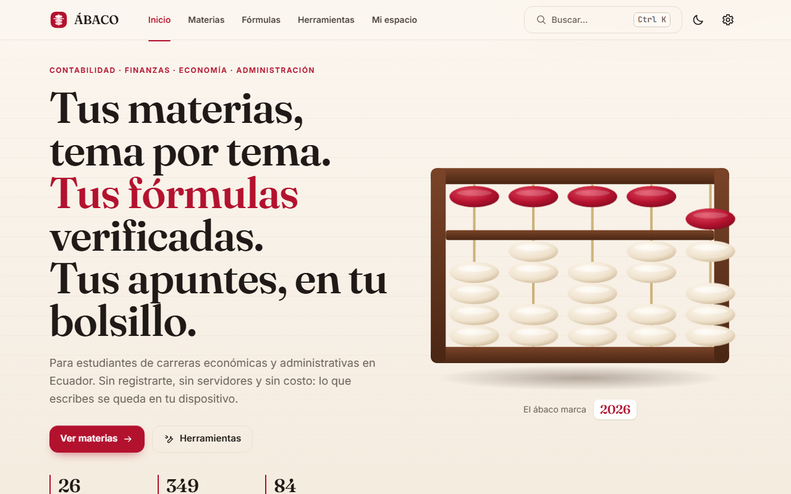
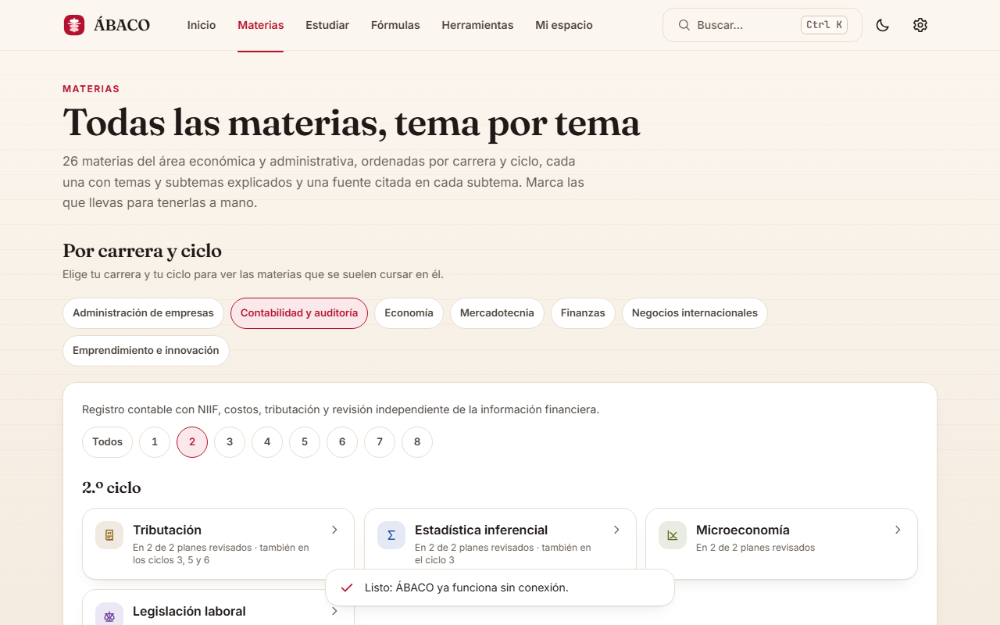
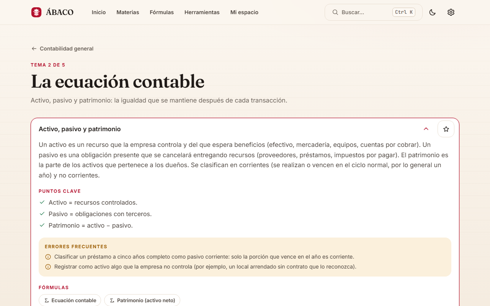
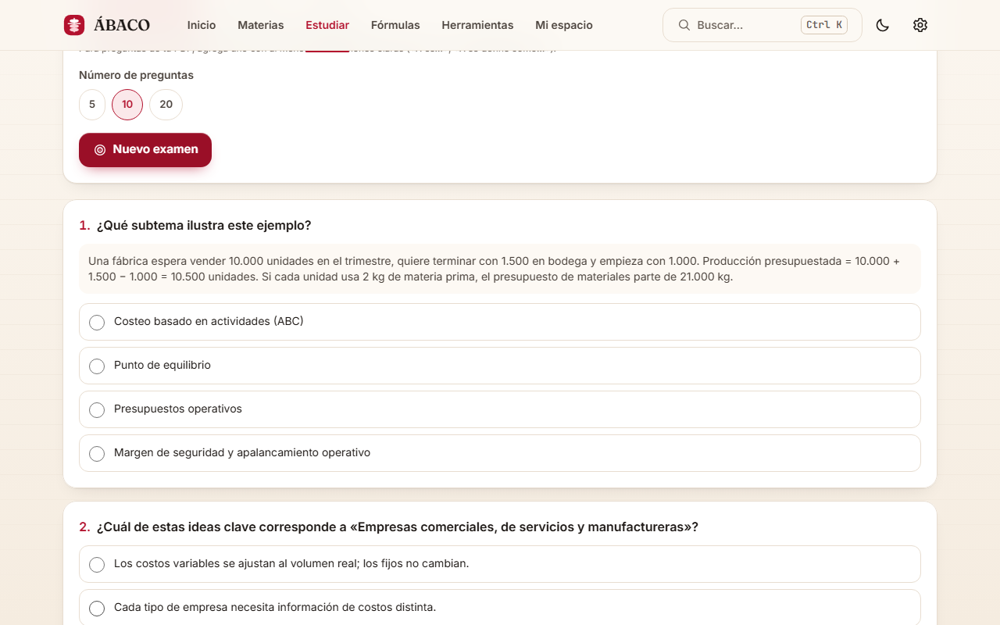
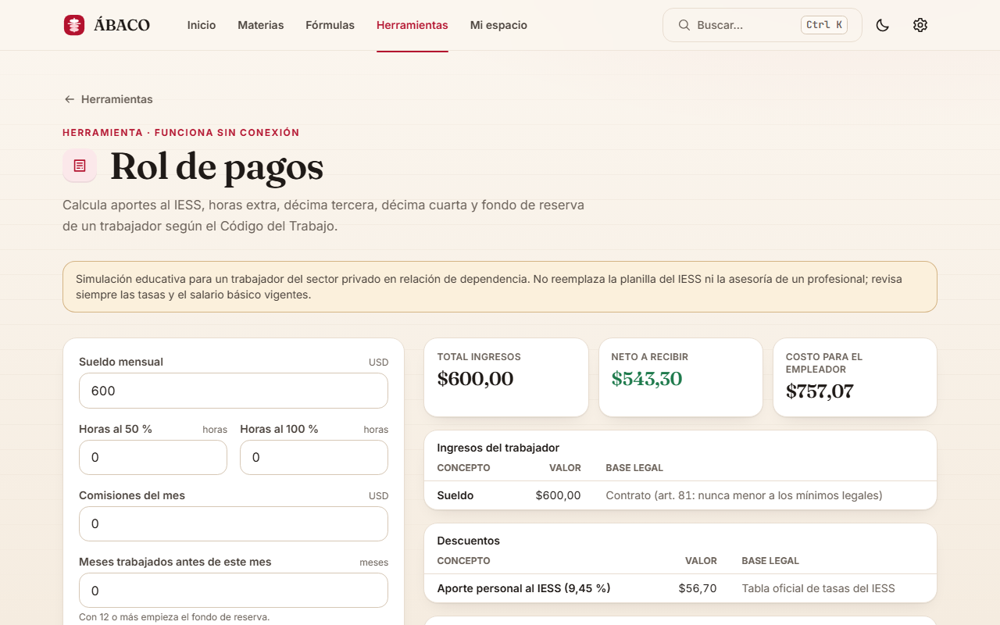
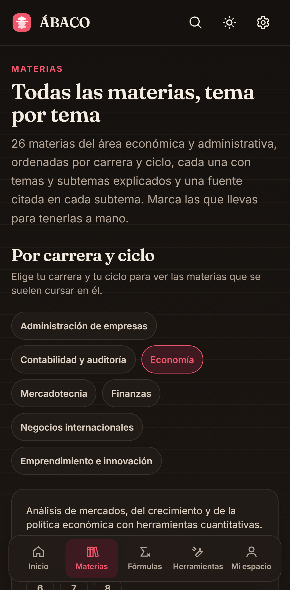
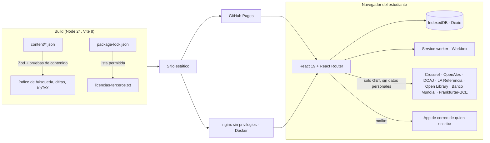
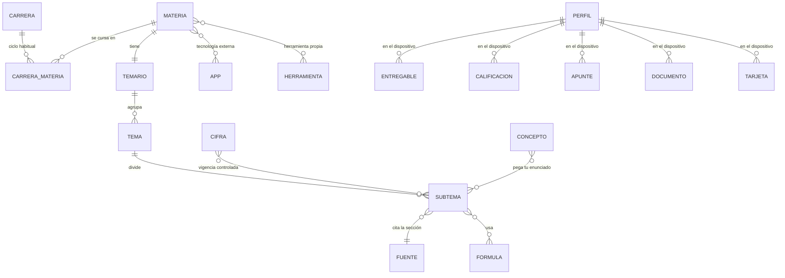

# ÁBACO

Estudia y resuelve los deberes de las carreras económicas y administrativas de Ecuador: **teoría por carrera, ciclo, tema y subtema**, **entregables paso a paso** con Excel de fórmulas vivas, **cifras normativas con vigencia** que avisan cuando caducan, un área de estudio con tus propios PDF y un modo profesor. Fuentes oficiales citadas en cada explicación. Gratis, sin cuentas y funciona sin internet.

[](https://github.com/DiegoFranciscoG/abaco/actions/workflows/ci.yml)
   
  [](LICENSE)
[](https://diegofranciscog.github.io/abaco/)

**Demo:** https://diegofranciscog.github.io/abaco/ · **Usuario de prueba:** no hace falta; ÁBACO no tiene cuentas y todo se guarda en tu dispositivo. Se instala como app desde el navegador (Ajustes → «Usar ÁBACO como app»).



| Carrera y ciclo | Subtema: teoría y ejemplo | Área de estudio: examen | Rol de pagos | Móvil, tema oscuro |
|---|---|---|---|---|
|  |  |  |  |  |

## Problema que resuelve

Quien estudia Contabilidad, Economía, Administración o Finanzas en Ecuador junta apuntes sueltos, PDF de dudosa procedencia y calculadoras con tablas tributarias o laborales desactualizadas. ÁBACO ordena las 26 materias más frecuentes de esas carreras por **carrera y ciclo habitual**, explica cada subtema con redacción propia y cita la sección exacta de la norma o del libro abierto que lo respalda, y trae herramientas que aplican la norma vigente (SRI, IESS, Código del Trabajo) con su fuente a la vista.

## Funcionalidades

- **Entregables paso a paso (8)**: rol de pagos, tabla de amortización, kardex, depreciación, punto de equilibrio, VAN y TIR, razones financieras y libro diario. Cada uno muestra el procedimiento con la expresión y el cálculo de cada paso, descarga un Excel con fórmulas vivas, se imprime como PDF y se guarda para seguir después.
- **Pega tu enunciado**: pegas el texto del deber y ÁBACO dice qué tema, fórmula, herramienta o entregable aplica (88 conceptos, 714 frases). Si no está seguro, lo dice en vez de adivinar.
- **Cifras con vigencia**: las 22 cifras normativas (SBU, IESS, IVA, tabla de renta, retenciones, RIMPE, Código del Trabajo, Ley de Compañías) viven en un solo catálogo con base legal y fechas; cada pantalla que las usa dice «vigente 2026» y avisa si una caducó. La prueba T-11 falla al día siguiente de su vencimiento y un flujo mensual la corre sola.
- **Ecuador en cifras hoy**: SBU, aportes, IVA, renta, retenciones, inflación del INEC y tasas del BCE con su fuente; se copian o se comparten como imagen.
- **¿Cuánto necesito para pasar?**: con los pesos y notas que puso tu docente calcula la nota que falta, con el procedimiento.
- **Repaso de errores**: las preguntas que fallas vuelven con repetición espaciada hasta acertarlas tres veces; búsqueda dentro de tus PDF.
- **Carrera → ciclo → materia → tema → subtema**: 7 carreras genéricas, 26 materias, 107 temas y 351 subtemas, sin nombres de universidades. El ciclo habitual sale de 13 planes públicos (método en [docs/investigacion.md](docs/investigacion.md#1b-carrera--ciclo--materia-sin-universidades)).
- **Cobertura honesta**: cada materia dice cuántas unidades tiene frente al estándar de profundidad (5 a 7 unidades, 2 ejercicios por subtema de cálculo); el panel «Cobertura» de la app y [docs/cobertura.md](docs/cobertura.md) muestran lo que falta por carrera y ciclo.
- **Teoría y ejemplo en cada subtema**: los 351 subtemas tienen explicación con fuente, un ejemplo concreto con cifras de Ecuador, puntos clave y errores frecuentes.
- **Área de estudio**: elige una materia y estudia con el contenido de ÁBACO, con tus propios PDF (se leen en tu dispositivo, no se suben) o con ambos: repaso, tarjetas para memorizar con repetición espaciada y exámenes de práctica calificados con su explicación.
- **Enviar un PDF al autor**: si un PDF puede servir a otros, ÁBACO revisa que tenga texto, que sea de la materia y que no tenga datos personales, y prepara el correo; lo verificado se redacta de nuevo y se agrega con su fuente.
- **93 fórmulas verificadas**: calculadora en vivo, sintaxis de Excel en español e inglés y un ejemplo que se recalcula en cada build.
- **17 herramientas propias**: calculadora de notas, editor de informes con fórmulas, libro diario y mayor, calculadora estadística, graficador, oferta y demanda, datos macro del Banco Mundial, tipos de cambio del BCE, punto de equilibrio, evaluador de proyectos (VAN, TIR), rol de pagos (IESS 2026), IVA e impuesto a la renta (tabla 2026), FODA y matriz de decisión, tarjetas con repetición espaciada (SM-2), referencias APA, laboratorio de hoja de cálculo y buscador académico.
- **Tecnología real en cada materia**: 25 aplicaciones externas verificadas en su sitio oficial (GnuCash, GanttProject, draw.io, SRI en línea, IESS, Ministerio del Trabajo, BCE, INEC, WITS, LimeSurvey y más).
- **Buscador académico** en 5 fuentes abiertas (Crossref, OpenAlex, DOAJ, LA Referencia, Open Library) con la cita APA lista.
- **Práctica**: 60 ejercicios con respuesta verificable en las materias de cálculo, pistas e historial; las materias teóricas se practican con tarjetas y exámenes.
- **15 plantillas de Excel por materia**: liquidación de IVA, estadística descriptiva, intervalo de confianza, tamaño de muestra, regresión, elasticidad, inflación con el IPC, tipo de cambio, costo marginal, SUMAR.SI y más; se abren en el laboratorio o se descargan directo como .xlsx.
- **Glosario español-inglés**: 85 términos; los 31 de NIIF usan el nombre de la traducción oficial de la Fundación IFRS. Se busca en los dos idiomas y se descarga en Excel.
- **Modo profesor**: el docente elige ejercicios, imprime la hoja del estudiante y el solucionario por separado y comparte un enlace para que cada estudiante los resuelva con corrección automática.
- **Mi espacio**: apuntes, estrellas, colecciones (compartibles por enlace, sin tus apuntes), recordatorios, respaldo en JSON y **avance por malla**: tu carrera ciclo por ciclo, con cada materia dominada, en curso o sin empezar.
- **Tu uso**: la app cuenta solo en tu dispositivo cuántos días la usaste, cuántos entregables resolviste y si volviste; tú decides si copias y envías un resumen anónimo.
- **Buzón de sugerencias**: rechaza insultos, mensajes sin sentido y datos personales, y prepara un correo en la aplicación de quien escribe; al terminar invita a conocer las redes y proyectos del autor ([captura](docs/img/buzon.png)).
- **PWA**: instalable, funciona sin conexión, tema claro y oscuro, respeta «reducir movimiento».

## Arquitectura



## Stack y por qué

| Capa | Tecnología | Motivo |
|---|---|---|
| Interfaz | React 19, TypeScript 6, Tailwind 4, Motion | Componentes accesibles y tipados; animaciones que respetan «reducir movimiento» |
| Rutas | React Router 8 con rutas *hash* y carga diferida | Funciona en GitHub Pages sin reescrituras y sin conexión |
| Datos locales | Dexie (IndexedDB) con migraciones versionadas | Sin servidor ni cuentas: privacidad por diseño (LOPDP art. 39) |
| Validación | Zod 4 | El mismo esquema valida contenido, respaldos y colecciones |
| Matemática | KaTeX, analizador de fórmulas propio, formulajs | Fórmulas sin `eval`; resultados iguales a Excel |
| Búsqueda | MiniSearch con índice generado al compilar | Búsqueda instantánea sin servidor |
| PWA | vite-plugin-pwa / Workbox | Instalable y sin conexión |
| PDF | pdf.js 6 (Mozilla, Apache-2.0) en un Web Worker | Lee el texto de los PDF en el navegador, sin subirlos ni ejecutar su contenido |
| 3D | Three.js (carga diferida) | Ábaco decorativo que no penaliza la primera carga |
| Pruebas | Vitest, Testing Library, Playwright, axe-core | Unitarias, integración, contenido, extremo a extremo y accesibilidad |
| DevOps | Docker (nginx sin privilegios), GitHub Actions, GitHub Pages | Despliegue gratis y reproducible |

## Modelo de datos

Detalle, reglas y migraciones en [docs/modelo-datos.md](docs/modelo-datos.md).



## Cómo ejecutar en local

Con Docker (sirve la misma build que producción, con las cabeceras de seguridad):

```bash
docker compose up --build
```

Abre http://localhost:8080. Sin Docker (Node 24):

```bash
npm ci
npm run dev
```

Para probar la build de producción con el service worker: `npm run build && npm run preview` (http://localhost:4173).

## Variables de entorno

ÁBACO no usa secretos ni claves de API. Copia `.env.example` a `.env` solo si quieres cambiar la ruta base.

| Variable | Descripción | Obligatoria |
|---|---|---|
| `VITE_BASE_PATH` | Ruta base de publicación: `/` en local y Docker, `/<repositorio>/` en GitHub Pages (el despliegue la pone solo) | No (por defecto `/`) |

## API

ÁBACO no expone una API propia: es un sitio estático. Consume APIs públicas, sin clave, solo con GET y desde el navegador:

| Fuente | Uso | Licencia |
|---|---|---|
| Crossref, OpenAlex, DOAJ, LA Referencia, Open Library | Buscador académico (solo metadatos) | Ver [docs/apis.md](docs/apis.md) |
| Banco Mundial, World Development Indicators | Herramienta «Datos macro» | CC BY 4.0 |
| Frankfurter con proveedor BCE | Herramienta «Divisas» | Código MIT; datos del BCE citando la fuente |

Peticiones de ejemplo en [docs/http/](docs/http/).

## Tests y cobertura

```bash
npm run lint && npm run format:check   # estilo
npm run test:coverage                  # 971 pruebas unitarias, de integración, de componentes y de contenido
npx playwright install chromium
npm run build && npx playwright test   # 100 pruebas de extremo a extremo, accesibilidad y seguridad
```

Cobertura de la lógica de negocio (`src/domain` y `src/data`): **95,0 % de líneas**, 80,8 % de ramas (umbral mínimo 70 %). Las pruebas de contenido recalculan cada ejemplo y ejercicio, comprueban fuentes, carreras y que ninguna materia quede sin herramienta ni tecnología externa. Las pruebas con nombre del plan v2: **T-11** (ninguna cifra vencida y toda cifra declarada), **T-12** (casos resueltos a mano de los 8 entregables), **T-13** (el Excel exportado, reabierto, da los mismos números), **T-14** (cada paso del procedimiento se evalúa con el motor de Excel), **T-16** (enunciados: 81 % en un conjunto ciego), **T-17** (cobertura declarada = medida) y **T-18** (compartir una colección no filtra apuntes ni fechas). Las e2e recorren la app como estudiante en escritorio y móvil, pasan axe en 37 vistas en tema claro y oscuro, leen un PDF real en el área de estudio, comprueban que nada personal salga a la red (T-04), que funcione sin internet (T-08), y que la app no se deje enmarcar ni ejecute código inyectado.

## Despliegue

GitHub Pages, gratis. `.github/workflows/deploy.yml` corre solo cuando la CI pasa en `main`: compila con `VITE_BASE_PATH` del repositorio y publica `dist/`. Para activarlo: Settings → Pages → Source: GitHub Actions. La imagen Docker sirve el mismo sitio con nginx para cualquier otro alojamiento.

## Seguridad aplicada

Modelo de amenazas y correspondencia con OWASP ASVS 5.0 en [docs/seguridad.md](docs/seguridad.md); política de reporte en [SECURITY.md](SECURITY.md).

- CSP estricta e idéntica en `<meta>` y nginx (`script-src 'self'`, `connect-src` con la lista exacta de APIs), sin scripts en línea ni `eval`.
- Anti-*clickjacking*: `frame-ancestors 'none'` y `X-Frame-Options` en nginx; detección del marco en GitHub Pages.
- Markdown y fórmulas sin ejecución de código; respaldos validados con Zod antes de tocar la base local.
- Sin cuentas, sin servidor, sin analítica, sin cookies; la prueba T-04 vigila el tráfico de red.
- CI con gitleaks (SHA-256 verificado), `npm audit`, licencias de dependencias en lista permitida, REUSE y acciones fijadas por SHA con permisos mínimos.
- Docker: nginx sin privilegios, solo lectura, sin capacidades, solo GET/HEAD y *healthcheck*.

## Decisiones técnicas

- **PDF leídos en el dispositivo:** pdf.js extrae el texto dentro de un Web Worker; el archivo nunca se sube y solo su texto se guarda en IndexedDB. Las preguntas y tarjetas salen de reglas comprobables (definiciones «X es…», subtemas, ejemplos), no de un modelo que pueda inventar respuestas.

- **Sin backend:** elimina cuentas, contraseñas y bases centrales que proteger; el costo es que los datos viven en cada dispositivo, por eso hay respaldo en JSON con migraciones probadas.
- **Contenido como datos versionados:** JSON validado con Zod y pruebas que recalculan cada número; un error de contenido rompe la build en vez de llegar al estudiante.
- **Carreras genéricas y ciclo habitual:** se agregan 13 planes públicos y se publica solo el resultado (mediana del primer ciclo, umbral de la mitad de los planes), sin reproducir ningún plan ni nombrar universidades.
- **Primero el contenido:** un *shell* estático se pinta antes del JavaScript y React monta después del primer cuadro; las fórmulas se componen al compilar.
- **Buzón sin servidor:** `mailto:` con validación previa evita guardar datos de terceros y contratar un servicio con transferencia internacional.
- **Normas cambiantes como datos con fecha de caducidad:** cada cifra vive una sola vez en `content/normativa.json` con su vigencia; las calculadoras la leen de ahí y una prueba la detecta en cualquier texto. Actualizar el SBU en enero es cambiar un JSON y ver qué fichas rompen.
- **Entregables como funciones puras:** cada entregable es `parse → compute → toSheet`; los pasos llevan la fórmula de Excel que se evalúa con el mismo motor de la app, así el procedimiento en pantalla, el Excel y el PDF no pueden contradecirse.
- **Enunciados con reglas explicables, no con un modelo:** frases en orden con tolerancia a palabras intermedias y una capa léxica débil; cuando la evidencia no alcanza, la app dice «no estoy seguro». Se mide con un conjunto ciego que no se usó para ajustar.
- **Compartir sin servidor:** colecciones y talleres viajan en el enlace después del `#`, con una lista blanca de campos y rutas solo internas.
- **Medir sin rastrear:** contadores por día en el propio dispositivo y un resumen anónimo que solo sale si el estudiante lo copia.

## Roadmap

- Llevar al estándar de profundidad las 25 materias que siguen parciales, empezando por el primer ciclo de las cuatro carreras más grandes ([docs/cobertura.md](docs/cobertura.md)).
- Publicar los porcentajes de retención del IVA cuando se confirme que no tienen reformas posteriores a 2023.
- Pasar el glosario y los subtemas NIIF a la edición 2025 de la NIIF para las PYMES, que rige desde el 01-01-2027.
- Revisar los PDF que envíen los estudiantes con `npm run pdf:analizar` y agregar lo verificado como subtemas, ejemplos o ejercicios con su fuente.
- Materias optativas frecuentes (auditoría, presupuestos, mercado de valores) cuando haya fuentes abiertas verificables.
- Formulario del buzón con un servicio propio si el volumen lo justifica (requiere actualizar la política de privacidad y la CSP).

## Fuentes de datos y licencias

- Normas oficiales de Ecuador (SRI, IESS, Ministerio del Trabajo, Código del Trabajo, Ley de Compañías, LOPDP): citadas y enlazadas (Código Ingenios, art. 107).
- Libros OpenStax (CC BY-NC-SA 4.0): solo se citan y enlazan por sección; no se copia su texto.
- Banco Mundial WDI (CC BY 4.0), BCE vía Frankfurter, Crossref, OpenAlex (CC0), DOAJ, LA Referencia y Open Library: ver [docs/apis.md](docs/apis.md).
- Investigación completa, con fecha de consulta y supuestos marcados: [docs/investigacion.md](docs/investigacion.md). Revisión legal: [docs/legal.md](docs/legal.md).
- Código y textos propios: MIT. Bibliotecas de terceros: `/licencias-terceros.txt` en el sitio publicado.

ÁBACO no está afiliado a ninguna universidad ni entidad pública. Su contenido es educativo y no reemplaza la asesoría de un profesional.

## Autor

**Diego Francisco Granda Zhingre** · [GitHub](https://github.com/DiegoFranciscoG) · [LinkedIn](https://www.linkedin.com/in/diego-francisco-g-61b793254/) · [Instagram](https://www.instagram.com/diego.granda.z/) · [Portafolio](https://diegofranciscog.github.io/)
