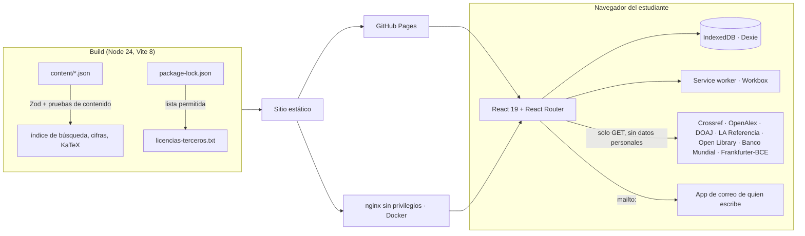
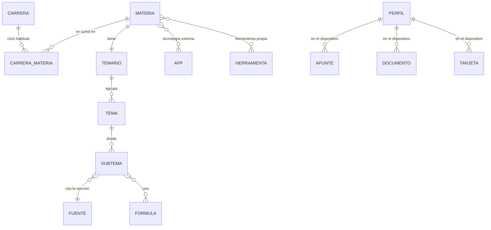

# ÁBACO

Estudia las materias de las carreras económicas y administrativas de Ecuador **por carrera, ciclo, tema y subtema**, con fórmulas verificadas, 16 herramientas de estudio y fuentes oficiales citadas en cada explicación. Gratis, sin cuentas y funciona sin internet.

[](https://github.com/DiegoFranciscoG/abaco/actions/workflows/ci.yml)
   
  [](LICENSE)
[](https://diegofranciscog.github.io/abaco/)

**Demo:** https://diegofranciscog.github.io/abaco/ · **Usuario de prueba:** no hace falta; ÁBACO no tiene cuentas y todo se guarda en tu dispositivo. Se instala como app desde el navegador (Ajustes → «Usar ÁBACO como app»).


| Carrera y ciclo | Subtema con su fuente | Rol de pagos | Móvil, tema oscuro |
|---|---|---|---|
|  |  |  |  |

## Problema que resuelve

Quien estudia Contabilidad, Economía, Administración o Finanzas en Ecuador junta apuntes sueltos, PDF de dudosa procedencia y calculadoras con tablas tributarias o laborales desactualizadas. ÁBACO ordena las 26 materias más frecuentes de esas carreras por **carrera y ciclo habitual**, explica cada subtema con redacción propia y cita la sección exacta de la norma o del libro abierto que lo respalda, y trae herramientas que aplican la norma vigente (SRI, IESS, Código del Trabajo) con su fuente a la vista.

## Funcionalidades

- **Carrera → ciclo → materia → tema → subtema**: 7 carreras genéricas, 26 materias, 107 temas y 349 subtemas, sin nombres de universidades. El ciclo habitual sale de 13 planes públicos (método en [docs/investigacion.md](docs/investigacion.md#1b-carrera--ciclo--materia-sin-universidades)).
- **84 fórmulas verificadas**: calculadora en vivo, sintaxis de Excel en español e inglés y un ejemplo que se recalcula en cada build.
- **16 herramientas propias**: editor de informes con fórmulas, libro diario y mayor, calculadora estadística, graficador, oferta y demanda, datos macro del Banco Mundial, tipos de cambio del BCE, punto de equilibrio, evaluador de proyectos (VAN, TIR), rol de pagos (IESS 2026), IVA e impuesto a la renta (tabla 2026), FODA y matriz de decisión, tarjetas con repetición espaciada (SM-2), referencias APA, laboratorio de hoja de cálculo y buscador académico.
- **Tecnología real en cada materia**: 25 aplicaciones externas verificadas en su sitio oficial (GnuCash, GanttProject, draw.io, SRI en línea, IESS, Ministerio del Trabajo, BCE, INEC, WITS, LimeSurvey y más).
- **Buscador académico** en 5 fuentes abiertas (Crossref, OpenAlex, DOAJ, LA Referencia, Open Library) con la cita APA lista.
- **Práctica**: 24 ejercicios con respuesta verificable, pistas e historial.
- **Mi espacio**: apuntes, estrellas, colecciones, recordatorios y respaldo en JSON; nada sale del dispositivo.
- **Buzón de sugerencias**: rechaza insultos, mensajes sin sentido y datos personales, y prepara un correo en la aplicación de quien escribe; al terminar invita a conocer las redes y proyectos del autor ([captura](docs/img/buzon.png)).
- **PWA**: instalable, funciona sin conexión, tema claro y oscuro, respeta «reducir movimiento».

## Arquitectura



## Stack y por qué

| Capa | Tecnología | Motivo |
|---|---|---|
| Interfaz | React 19, TypeScript 6, Tailwind 4, Motion | Componentes accesibles y tipados; animaciones que respetan «reducir movimiento» |
| Rutas | React Router 8 con rutas *hash* y carga diferida | Funciona en GitHub Pages sin reescrituras y sin conexión |
| Datos locales | Dexie (IndexedDB) con migraciones versionadas | Sin servidor ni cuentas: privacidad por diseño (LOPDP art. 39) |
| Validación | Zod 4 | El mismo esquema valida contenido, respaldos y colecciones |
| Matemática | KaTeX, analizador de fórmulas propio, formulajs | Fórmulas sin `eval`; resultados iguales a Excel |
| Búsqueda | MiniSearch con índice generado al compilar | Búsqueda instantánea sin servidor |
| PWA | vite-plugin-pwa / Workbox | Instalable y sin conexión |
| 3D | Three.js (carga diferida) | Ábaco decorativo que no penaliza la primera carga |
| Pruebas | Vitest, Testing Library, Playwright, axe-core | Unitarias, integración, contenido, extremo a extremo y accesibilidad |
| DevOps | Docker (nginx sin privilegios), GitHub Actions, GitHub Pages | Despliegue gratis y reproducible |

## Modelo de datos

Detalle, reglas y migraciones en [docs/modelo-datos.md](docs/modelo-datos.md).



## Cómo ejecutar en local

Con Docker (sirve la misma build que producción, con las cabeceras de seguridad):

```bash
docker compose up --build
```

Abre http://localhost:8080. Sin Docker (Node 24):

```bash
npm ci
npm run dev
```

Para probar la build de producción con el service worker: `npm run build && npm run preview` (http://localhost:4173).

## Variables de entorno

ÁBACO no usa secretos ni claves de API. Copia `.env.example` a `.env` solo si quieres cambiar la ruta base.

| Variable | Descripción | Obligatoria |
|---|---|---|
| `VITE_BASE_PATH` | Ruta base de publicación: `/` en local y Docker, `/<repositorio>/` en GitHub Pages (el despliegue la pone solo) | No (por defecto `/`) |

## API

ÁBACO no expone una API propia: es un sitio estático. Consume APIs públicas, sin clave, solo con GET y desde el navegador:

| Fuente | Uso | Licencia |
|---|---|---|
| Crossref, OpenAlex, DOAJ, LA Referencia, Open Library | Buscador académico (solo metadatos) | Ver [docs/apis.md](docs/apis.md) |
| Banco Mundial, World Development Indicators | Herramienta «Datos macro» | CC BY 4.0 |
| Frankfurter con proveedor BCE | Herramienta «Divisas» | Código MIT; datos del BCE citando la fuente |

Peticiones de ejemplo en [docs/http/](docs/http/).

## Tests y cobertura

```bash
npm run lint && npm run format:check   # estilo
npm run test:coverage                  # 686 pruebas unitarias, de integración, de componentes y de contenido
npx playwright install chromium
npm run build && npx playwright test   # 76 pruebas de extremo a extremo, accesibilidad y seguridad
```

Cobertura de la lógica de negocio (`src/domain` y `src/data`): **93,5 % de líneas**, 79,7 % de ramas (umbral mínimo 70 %). Las pruebas de contenido recalculan cada ejemplo y ejercicio, comprueban fuentes, carreras y que ninguna materia quede sin herramienta ni tecnología externa. Las e2e recorren la app como estudiante en escritorio y móvil, pasan axe en 26 vistas en tema claro y oscuro, comprueban que nada personal salga a la red (T-04), que funcione sin internet (T-08), y que la app no se deje enmarcar ni ejecute código inyectado.

## Despliegue

GitHub Pages, gratis. `.github/workflows/deploy.yml` corre solo cuando la CI pasa en `main`: compila con `VITE_BASE_PATH` del repositorio y publica `dist/`. Para activarlo: Settings → Pages → Source: GitHub Actions. La imagen Docker sirve el mismo sitio con nginx para cualquier otro alojamiento.

## Seguridad aplicada

Modelo de amenazas y correspondencia con OWASP ASVS 5.0 en [docs/seguridad.md](docs/seguridad.md); política de reporte en [SECURITY.md](SECURITY.md).

- CSP estricta e idéntica en `<meta>` y nginx (`script-src 'self'`, `connect-src` con la lista exacta de APIs), sin scripts en línea ni `eval`.
- Anti-*clickjacking*: `frame-ancestors 'none'` y `X-Frame-Options` en nginx; detección del marco en GitHub Pages.
- Markdown y fórmulas sin ejecución de código; respaldos validados con Zod antes de tocar la base local.
- Sin cuentas, sin servidor, sin analítica, sin cookies; la prueba T-04 vigila el tráfico de red.
- CI con gitleaks (SHA-256 verificado), `npm audit`, licencias de dependencias en lista permitida, REUSE y acciones fijadas por SHA con permisos mínimos.
- Docker: nginx sin privilegios, solo lectura, sin capacidades, solo GET/HEAD y *healthcheck*.

## Decisiones técnicas

- **Sin backend:** elimina cuentas, contraseñas y bases centrales que proteger; el costo es que los datos viven en cada dispositivo, por eso hay respaldo en JSON con migraciones probadas.
- **Contenido como datos versionados:** JSON validado con Zod y pruebas que recalculan cada número; un error de contenido rompe la build en vez de llegar al estudiante.
- **Carreras genéricas y ciclo habitual:** se agregan 13 planes públicos y se publica solo el resultado (mediana del primer ciclo, umbral de la mitad de los planes), sin reproducir ningún plan ni nombrar universidades.
- **Primero el contenido:** un *shell* estático se pinta antes del JavaScript y React monta después del primer cuadro; las fórmulas se componen al compilar.
- **Buzón sin servidor:** `mailto:` con validación previa evita guardar datos de terceros y contratar un servicio con transferencia internacional.
- **Normas cambiantes como parámetros:** IVA, SBU y divisor de horas son editables y muestran su fuente y fecha.

## Roadmap

- Más ejercicios por materia y tarjetas generadas desde cada subtema.
- Materias optativas frecuentes (auditoría, presupuestos, mercado de valores) cuando haya fuentes abiertas verificables.
- Revisión anual de tablas del SRI, IESS y SBU con fecha visible.
- Formulario del buzón con un servicio propio si el volumen lo justifica (requiere actualizar la política de privacidad y la CSP).

## Fuentes de datos y licencias

- Normas oficiales de Ecuador (SRI, IESS, Ministerio del Trabajo, Código del Trabajo, Ley de Compañías, LOPDP): citadas y enlazadas (Código Ingenios, art. 107).
- Libros OpenStax (CC BY-NC-SA 4.0): solo se citan y enlazan por sección; no se copia su texto.
- Banco Mundial WDI (CC BY 4.0), BCE vía Frankfurter, Crossref, OpenAlex (CC0), DOAJ, LA Referencia y Open Library: ver [docs/apis.md](docs/apis.md).
- Investigación completa, con fecha de consulta y supuestos marcados: [docs/investigacion.md](docs/investigacion.md). Revisión legal: [docs/legal.md](docs/legal.md).
- Código y textos propios: MIT. Bibliotecas de terceros: `/licencias-terceros.txt` en el sitio publicado.

ÁBACO no está afiliado a ninguna universidad ni entidad pública. Su contenido es educativo y no reemplaza la asesoría de un profesional.

## Autor

**Diego Francisco Granda Zhingre** · [GitHub](https://github.com/DiegoFranciscoG) · [LinkedIn](https://www.linkedin.com/in/diego-francisco-g-61b793254/) · [Instagram](https://www.instagram.com/diego.granda.z/) · [Portafolio](https://diegofranciscog.github.io/)
