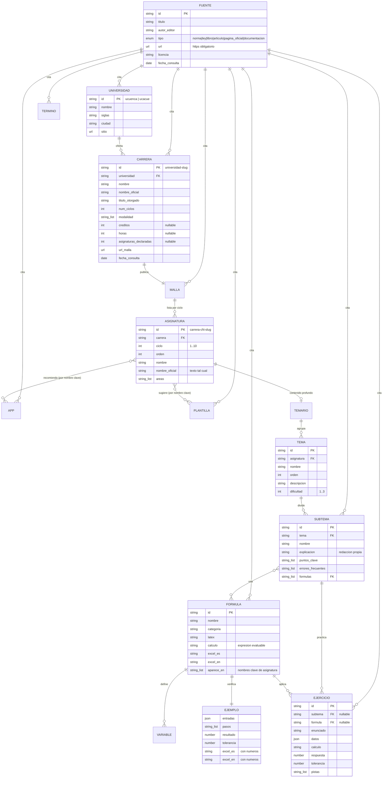
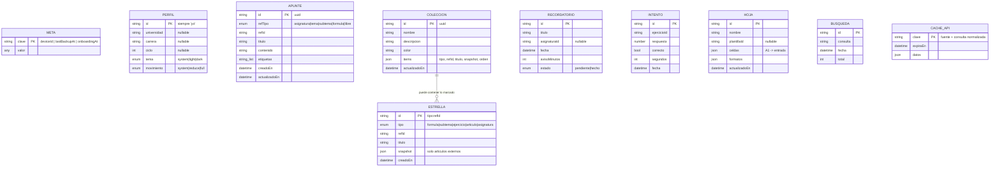

# Modelo de datos

ÁBACO tiene dos modelos separados a propósito:

1. **Contenido académico** — archivos JSON versionados en `content/`, validados con Zod en cada build y en CI. Es igual para todos y nunca se modifica desde la app.
2. **Datos del estudiante** — IndexedDB (Dexie) dentro del navegador. Nunca salen del dispositivo, salvo en el archivo de respaldo que el propio estudiante descarga.

## 1. Contenido académico

### Reglas de negocio del contenido (se hacen cumplir con código)

| Regla | Dónde se valida | Prueba |
|---|---|---|
| Toda ficha resuelve a una fuente con URL `https://` y `fecha_consulta` válida | `src/domain/content/schemas.ts` + `tests/content/t01-sources.test.ts` | **T-01** |
| Cada ejemplo numérico se recalcula con el motor de fórmulas (expresión algebraica **y** sintaxis Excel en inglés **y** en español) y debe coincidir con el resultado publicado dentro de la tolerancia | `tests/content/t02-examples.test.ts` | **T-02** |
| Cada ejercicio se recalcula y debe dar la respuesta publicada | `tests/content/t02-examples.test.ts` | T-02 |
| Identificadores únicos en todo el contenido | `tests/content/integrity.test.ts` | integridad |
| Toda referencia (`formula`, `subtema`, `asignatura`, `aparece_en`, `ref` de fuente) existe | `tests/content/integrity.test.ts` | integridad |
| El número de asignaturas cargadas por carrera coincide con el conteo extraído de la página oficial | `tests/content/integrity.test.ts` | integridad |
| Una ficha con `estado: "pendiente"` nunca se muestra | `src/data/content-repository.ts` | unitaria |

`fuente` en cada ficha es `{ ref, url?, seccion? }`: `ref` apunta al catálogo `content/fuentes.json` (título, tipo, licencia, fecha) y `url` permite citar la sección exacta (por ejemplo, el capítulo 8.3 de OpenStax).

### Áreas (identidad visual por área)

`contabilidad` · `finanzas` · `tributario` · `cuantitativo` (matemática y estadística) · `derecho` · `gestion` (administración, marketing, talento humano) · `economia` · `tecnologia` · `formacion` (investigación, ética, prácticas, titulación, idiomas). La clasificación de cada asignatura se hace con reglas por palabra clave en el script de importación y se revisa a mano.

## 2. Datos del estudiante (IndexedDB, solo en el dispositivo)

### Versiones del esquema y migraciones (Dexie)

| Versión | Cambio | Migración |
|---|---|---|
| 1 | Apuntes ligados solo a asignatura (`asignaturaId`), sin etiquetas | — |
| 2 | Apuntes ligados a cualquier nivel (`refTipo` + `refId`), con `etiquetas`; nuevas tablas `hojas`, `busquedas`, `cacheApi`, `meta` | `upgrade()` copia `asignaturaId` → `refTipo='asignatura'`, `refId`; `etiquetas=[]` (prueba **T-05**) |

El archivo de respaldo (`abaco-respaldo-<id-local>-<fecha>.json`) declara `formato` y `version`; al restaurar se valida con Zod y, si viene de una versión anterior, pasa por la misma migración (prueba **T-06**).

### Privacidad (LOPDP — minimización)

- No hay cuentas, ni servidor, ni analítica. No se pide nombre, cédula, correo ni teléfono.
- El identificador local es aleatorio (`crypto.randomUUID()`), se genera en el dispositivo y **solo** se usa en el nombre del archivo de respaldo. La prueba **T-04** registra todo el tráfico de red y falla si aparece.
- Lo único que sale a la red son las consultas del buscador académico (el texto buscado) hacia las APIs listadas en `docs/apis.md`.
