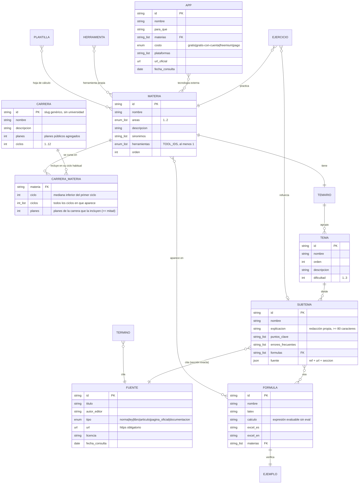

# Modelo de datos

ÁBACO tiene dos modelos separados a propósito:

1. **Contenido académico**: archivos JSON versionados en `content/`, validados con Zod en cada build y en la CI. Es igual para todos y nunca se modifica desde la app.
2. **Datos del estudiante**: IndexedDB (Dexie) dentro del navegador. Nunca salen del dispositivo, salvo en el archivo de respaldo que se descarga desde Ajustes o en el correo que se envía, por decisión propia, desde el buzón de sugerencias.

## 1. Contenido académico: carrera → ciclo → materia → tema → subtema

### Reglas de negocio del contenido (se hacen cumplir con código)

| Regla | Dónde se valida | Prueba |
|---|---|---|
| Toda ficha resuelve a una fuente con URL `https://` y `fecha_consulta` válida | `src/domain/content/schemas.ts` | `tests/content/t01-sources.test.ts` (T-01) |
| Cada ejemplo y cada ejercicio se recalculan con el motor de fórmulas (expresión y sintaxis de Excel en inglés y en español) | motor de fórmulas | `tests/content/t02-examples.test.ts` (T-02) |
| Identificadores únicos y referencias existentes (materia, fórmula, subtema, fuente) | esquemas + integridad | `tests/content/integrity.test.ts` |
| Carreras: materias existentes, ciclo habitual dentro de los ciclos de la carrera y entre los ciclos en que aparece, solo materias presentes en al menos la mitad de los planes, ninguna materia sin carrera | `carreraSchema` | integridad |
| Cada materia tiene al menos una herramienta propia y una tecnología externa verificada | `materiaSchema` + `apps.json` | integridad |
| Ningún contenido publica mallas, nombres ni marcas de universidades | expresión regular de términos prohibidos | integridad |
| Cada subtema cita una sección que existe y contiene lo que afirma | descarga del texto de cada sección citada y búsqueda de la evidencia | resultado en [verificacion-contenido.md](verificacion-contenido.md) |

El método con el que se obtuvieron `carreras.json` (carrera genérica, ciclo habitual y umbral de la mitad de los planes) está en [investigacion.md](investigacion.md), sección 1b.

### Áreas (identidad visual)

`contabilidad` · `finanzas` · `tributario` · `cuantitativo` · `derecho` · `gestion` · `economia` · `tecnologia` · `formacion`.

## 2. Datos del estudiante (IndexedDB, solo en el dispositivo)

```mermaid
erDiagram
  PERFIL {
    string id PK "siempre 'yo'"
    string_list materias "ids del catálogo"
    string carrera "nullable, id de carreras.json"
    int ciclo "nullable"
    enum tema "system|light|dark"
    enum movimiento "system|reduce|full"
    enum sintaxisExcel "es|en"
  }
  APUNTE {
    string id PK
    enum refTipo "materia|tema|subtema|formula|libre"
    string refId
    string titulo
    string contenido "<= 20 000"
    string_list etiquetas
    datetime actualizadoEn
  }
  ESTRELLA {
    string id PK "tipo:refId"
    enum tipo "formula|subtema|ejercicio|articulo|materia"
    string refId
    json snapshot "solo artículos externos"
  }
  COLECCION {
    string id PK
    string nombre
    json items
  }
  RECORDATORIO {
    string id PK
    string titulo
    string materiaId "nullable"
    datetime fecha
    enum estado "pendiente|hecho"
  }
  INTENTO {
    string id PK
    string ejercicioId
    bool correcto
  }
  HOJA {
    string id PK
    json celdas
  }
  DOCUMENTO {
    string id PK
    string titulo
    string contenido "Markdown + KaTeX"
    string materiaId "nullable"
  }
  DIARIO {
    string id PK
    string nombre
    json asientos "partida doble validada"
  }
  TARJETA {
    string id PK
    string mazo
    enum origen "glosario|subtema|propia"
    number ef "SM-2"
    int intervalo
    datetime proximaRevision
  }
  TABLERO {
    string id PK
    enum tipo "foda|decision"
    json contenido
  }
  BUSQUEDA {
    string id PK
    string consulta
  }
  CACHE_API {
    string clave PK
    int expiraEn
    json datos
  }
  META {
    string clave PK "deviceId | lastBackupAt | onboardingAt"
    any valor
  }
  COLECCION ||--o{ ESTRELLA : "puede contener lo marcado"
```

Fuera de IndexedDB, el navegador guarda en `localStorage` dos claves pequeñas: `abaco:pantalla` (tema y animaciones, para aplicarlos antes de pintar) y `abaco:buzon` (hora de las últimas sugerencias y una huella FNV-1a de cada texto, nunca el texto).

### Versiones del esquema y migraciones (Dexie)

| Versión | Cambio | Migración y prueba |
|---|---|---|
| 1 | Apuntes ligados a una asignatura de una malla | — |
| 2 | Apuntes ligados a cualquier nivel (`refTipo` + `refId`) con etiquetas; tablas `hojas`, `busquedas`, `cacheApi`, `meta` | `upgradeToV2` (T-05) |
| 3 | Catálogo de materias en lugar de mallas; tablas de herramientas `documentos`, `diarios`, `tarjetas`, `tableros`; perfil con `materias`, `carrera` y `ciclo` genéricos | `upgradeToV3`: cada id antiguo de asignatura pasa a su materia con `legacyMateria`; la carrera y el ciclo antiguos (ligados a una universidad) se descartan (`tests/integration/storage.test.ts`) |

El respaldo (`abaco-respaldo-<id-local>-<fecha>.json`) declara `formato` y `version`; al restaurar se comprueba primero el formato, después el esquema Zod, y los respaldos v1 y v2 pasan por las mismas migraciones (T-06).

### Privacidad (LOPDP, minimización)

- No hay cuentas, servidor ni analítica. La app no pide nombre, cédula, correo ni teléfono.
- El identificador local es aleatorio (`crypto.randomUUID()`) y solo nombra los respaldos. La prueba T-04 registra todo el tráfico de red y falla si aparece, igual que si sale un apunte, un documento o el nombre de una colección.
- Las únicas conexiones externas son las APIs de [apis.md](apis.md), y solo reciben lo que se busca o se elige (texto buscado, indicador y países, monedas).
- El buzón de sugerencias no envía nada por sí mismo: prepara el correo en la aplicación de correo de quien escribe y bloquea cédulas, teléfonos y correos dentro del mensaje.
