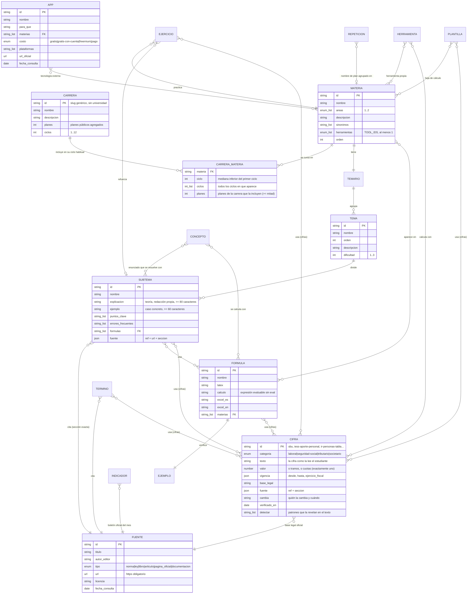

# Modelo de datos

ÁBACO tiene dos modelos separados a propósito:

1. **Contenido académico**: archivos JSON versionados en `content/`, validados con Zod en cada build y en la CI. Es igual para todos y nunca se modifica desde la app.
2. **Datos del estudiante**: IndexedDB (Dexie) dentro del navegador. Nunca salen del dispositivo, salvo en el archivo de respaldo que se descarga desde Ajustes o en el correo que se envía, por decisión propia, desde el buzón de sugerencias.

## 1. Contenido académico: carrera → ciclo → materia → tema → subtema

### Reglas de negocio del contenido (se hacen cumplir con código)

| Regla | Dónde se valida | Prueba |
|---|---|---|
| Toda ficha resuelve a una fuente con URL `https://` y `fecha_consulta` válida | `src/domain/content/schemas.ts` | `tests/content/t01-sources.test.ts` (T-01) |
| Cada ejemplo y cada ejercicio se recalculan con el motor de fórmulas (expresión y sintaxis de Excel en inglés y en español) | motor de fórmulas | `tests/content/t02-examples.test.ts` (T-02) |
| Identificadores únicos y referencias existentes (materia, fórmula, subtema, fuente) | esquemas + integridad | `tests/content/integrity.test.ts` |
| Carreras: materias existentes, ciclo habitual dentro de los ciclos de la carrera y entre los ciclos en que aparece, solo materias presentes en al menos la mitad de los planes, ninguna materia sin carrera | `carreraSchema` | integridad |
| Cada materia tiene al menos una herramienta propia y una tecnología externa verificada | `materiaSchema` + `apps.json` | integridad |
| Cada materia, tema y subtema tiene teoría, y cada subtema un ejemplo | `subtemaSchema` (`ejemplo` obligatorio) | integridad |
| Toda cifra normativa tiene vigencia dentro de su ejercicio fiscal, base legal y fuente oficial; las tablas por tramos encadenan | `cifraSchema` | `tests/content/t11-vigencia.test.ts` (T-11) |
| Ninguna cifra se muestra vencida: T-11 falla desde el día siguiente a su `hasta` y avisa 60 días antes; un flujo mensual la corre sin cambios en el código | `vigenciaStatus` + `.github/workflows/vigencia.yml` | T-11 |
| Toda ficha que menciona una cifra la declara, y solo declara cifras que menciona con su valor actual | `detectCifras` (`src/domain/content/vigencia.ts`) | T-11 |
| Rol de pagos e impuestos calculan con las cifras del catálogo, nunca con números escritos en el código | `src/domain/content/normativa.ts` | `tests/unit/vigencia.test.ts` |
| Una plantilla de Excel que declara una cifra normativa tiene su valor vigente en una celda (la etiqueta dice «IVA 15 %» y la celda vale 0,15) | `plantillaSchema.cifras` | T-11 |
| Cada plantilla descargada como .xlsx, reabierta y recalculada da los valores verificados, con las fórmulas vivas | `exportXlsx` + `importSpreadsheet` | `tests/content/plantillas-excel.test.ts` |
| Toda materia con subtemas de cálculo tiene al menos un Excel: una plantilla o un entregable | catálogo de entregables + `plantillas.json` | ídem |
| Un enunciado se asocia a un concepto solo con evidencia suficiente; si no, la app dice que no está segura (más de 70 % de acierto en el conjunto ciego) | `src/domain/statement/match.ts` | `tests/content/t16-enunciados.test.ts` (T-16) |
| El estado declarado de cada materia (`cobertura.estado`) coincide con lo que mide el estándar de profundidad, y `docs/cobertura.md` está al día | `materiaCoverage` | `tests/content/t17-cobertura.test.ts` (T-17) |
| La aritmética escrita en ejemplos, teoría y procedimientos cuadra («a × b = c» se recalcula) | `checkArithmetic` | integridad |
| El glosario tiene una sola entrada por término en cada idioma, y los nombres NIIF citan la traducción oficial | integridad | integridad |
| Ningún contenido publica mallas, nombres ni marcas de universidades | expresión regular de términos prohibidos | integridad |
| Cada subtema cita una sección que existe y contiene lo que afirma | descarga del texto de cada sección citada y búsqueda de la evidencia | resultado en [verificacion-contenido.md](verificacion-contenido.md) |

El método con el que se obtuvieron `carreras.json` (carrera genérica, ciclo habitual y umbral de la mitad de los planes) está en [investigacion.md](investigacion.md), sección 1b.

### Áreas (identidad visual)

`contabilidad` · `finanzas` · `tributario` · `cuantitativo` · `derecho` · `gestion` · `economia` · `tecnologia` · `formacion`.

## 2. Datos del estudiante (IndexedDB, solo en el dispositivo)

```mermaid
erDiagram
  PERFIL {
    string id PK "siempre 'yo'"
    string_list materias "ids del catálogo"
    string carrera "nullable, id de carreras.json"
    int ciclo "nullable"
    enum tema "system|light|dark"
    enum movimiento "system|reduce|full"
    enum sintaxisExcel "es|en"
  }
  APUNTE {
    string id PK
    enum refTipo "materia|tema|subtema|formula|libre"
    string refId
    string titulo
    string contenido "<= 20 000"
    string_list etiquetas
    datetime actualizadoEn
  }
  ESTRELLA {
    string id PK "tipo:refId"
    enum tipo "formula|subtema|ejercicio|articulo|materia"
    string refId
    json snapshot "solo artículos externos"
  }
  COLECCION {
    string id PK
    string nombre
    json items
  }
  RECORDATORIO {
    string id PK
    string titulo
    string materiaId "nullable"
    datetime fecha
    enum estado "pendiente|hecho"
  }
  INTENTO {
    string id PK
    string ejercicioId
    bool correcto
  }
  HOJA {
    string id PK
    json celdas
  }
  DOCUMENTO {
    string id PK
    string titulo
    string contenido "Markdown + KaTeX"
    string materiaId "nullable"
  }
  DIARIO {
    string id PK
    string nombre
    json asientos "partida doble validada"
  }
  TARJETA {
    string id PK
    string mazo
    enum origen "glosario|subtema|propia"
    number ef "SM-2"
    int intervalo
    datetime proximaRevision
  }
  TABLERO {
    string id PK
    enum tipo "foda|decision"
    json contenido
  }
  BUSQUEDA {
    string id PK
    string consulta
  }
  CACHE_API {
    string clave PK
    int expiraEn
    json datos
  }
  DOCUMENTO_PDF {
    string id PK
    string nombre
    string materiaId
    int paginas
    string texto "solo el texto, <= 400 000; el archivo no se guarda"
  }
  EXAMEN {
    string id PK
    string materiaId
    enum fuentes "abaco|pdf|mixto"
    int total
    int correctas
    int segundos
  }
  CALIFICACION {
    string id PK
    string materiaId
    string periodo "etiqueta libre, p. ej. 2026-2"
    number notaMaxima "escala del estudiante: 10, 20, 100"
    number objetivo "nota final que quiere alcanzar"
    json componentes "nombre, peso %, nota (nullable)"
  }
  ERROR_REPASO {
    string id PK "el mismo de la pregunta"
    string materiaId
    string subtemaId "nullable"
    json pregunta "la pregunta tal como se mostró"
    int fallos
    int aciertos "dominada al llegar a 3"
    number ef "SM-2"
    datetime proximaRevision
    bool dominada
  }
  ENTREGABLE {
    string id PK
    enum tipo "8 entregables"
    string titulo
    json entradas "solo lo que el estudiante escribió"
    datetime actualizadoEn
  }
  USO_DIA {
    string dia PK "AAAA-MM-DD"
    json eventos "conteos por tipo, sin contenido"
  }
  META {
    string clave PK "deviceId | lastBackupAt | onboardingAt"
    any valor
  }
  COLECCION ||--o{ ESTRELLA : "puede contener lo marcado"
```

Fuera de IndexedDB, el navegador guarda en `localStorage` dos claves pequeñas: `abaco:pantalla` (tema y animaciones, para aplicarlos antes de pintar) y `abaco:buzon` (hora de las últimas sugerencias y una huella FNV-1a de cada texto, nunca el texto).

### Versiones del esquema y migraciones (Dexie)

| Versión | Cambio | Migración y prueba |
|---|---|---|
| 1 | Apuntes ligados a una asignatura de una malla | — |
| 2 | Apuntes ligados a cualquier nivel (`refTipo` + `refId`) con etiquetas; tablas `hojas`, `busquedas`, `cacheApi`, `meta` | `upgradeToV2` (T-05) |
| 3 | Catálogo de materias en lugar de mallas; tablas de herramientas `documentos`, `diarios`, `tarjetas`, `tableros`; perfil con `materias`, `carrera` y `ciclo` genéricos | `upgradeToV3`: cada id antiguo de asignatura pasa a su materia con `legacyMateria`; la carrera y el ciclo antiguos (ligados a una universidad) se descartan (`tests/integration/storage.test.ts`) |
| 4 | Área de estudio: tablas `pdfs` (texto de los PDF del estudiante) y `examenes` | Sin transformación de datos; los respaldos v3 se aceptan con listas vacías (`tests/integration/study-storage.test.ts`) |
| 5 | Herramientas de todos los días: `calificaciones` (¿cuánto necesito?), `errores` (repaso espaciado de lo fallado), `entregables` guardados y `uso` (contadores por día) | Sin transformación; los respaldos v4 se aceptan con las cuatro listas vacías (`tests/integration/everyday-storage.test.ts`) |

El respaldo (`abaco-respaldo-<id-local>-<fecha>.json`) declara `formato` y `version`; al restaurar se comprueba primero el formato, después el esquema Zod, y los respaldos v1 y v2 pasan por las mismas migraciones (T-06).

### Privacidad (LOPDP, minimización)

- No hay cuentas, servidor ni analítica. La app no pide nombre, cédula, correo ni teléfono.
- El identificador local es aleatorio (`crypto.randomUUID()`) y solo nombra los respaldos. La prueba T-04 registra todo el tráfico de red y falla si aparece, igual que si sale un apunte, un documento o el nombre de una colección.
- Las únicas conexiones externas son las APIs de [apis.md](apis.md), y solo reciben lo que se busca o se elige (texto buscado, indicador y países, monedas).
- Los contadores de uso (`USO_DIA`) guardan solo cuántas veces se hizo cada cosa por día. Se ven en Ajustes → «Tu uso» y solo salen si el estudiante copia el resumen anónimo (números y mes, sin fechas ni identificadores) y decide enviarlo.
- Los enlaces que el estudiante comparte llevan lo mínimo: una colección, su nombre, descripción, color y la lista de elementos (sin apuntes ni fechas, T-18); un taller del modo profesor, su título y los ids de los ejercicios. Viajan después del `#`, que no se envía al servidor.
- El buzón de sugerencias no envía nada por sí mismo: prepara el correo en la aplicación de correo de quien escribe y bloquea cédulas, teléfonos y correos dentro del mensaje.
